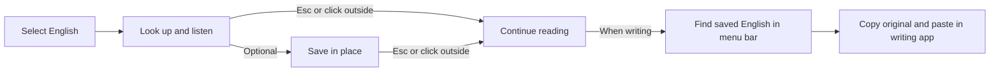

<p align="center">
  
</p>

<h1 align="center">Useleaf · 拾用</h1>
<p align="center">Turn the English you encounter into expressions you can use.</p>
<p align="center"><a href="README.md">简体中文</a> · <a href="https://github.com/yuki-uix/useleaf/releases/latest">Download for macOS</a> · <a href="docs/PRIVACY.md">Privacy</a></p>

Useleaf is a quiet menu-bar companion for reading and using English on macOS. Select a word, phrase or sentence, look it up and listen, then optionally save the original. When you are writing, find it again from the menu bar and copy it back into your work.

The current interface and English-to-Chinese translations are designed for Chinese-speaking learners. No account or cloud language-model service is required.

The current version is **0.8.0 (build 11)**. See the [0.8.0 release notes](docs/releases/v0.8.0.md) for the lightweight companion update.

## Download and install

The current release, **0.8.0 (build 11)**, is available for **Apple Silicon Macs (arm64)**. Intel binaries are not included in this release.

- [Latest release](https://github.com/yuki-uix/useleaf/releases/latest)
- [Useleaf 0.8.0 DMG](https://github.com/yuki-uix/useleaf/releases/download/v0.8.0/Useleaf-0.8.0-macos-arm64.dmg)
- [Useleaf 0.8.0 ZIP](https://github.com/yuki-uix/useleaf/releases/download/v0.8.0/Useleaf-0.8.0-macos-arm64.zip)
- [SHA256SUMS](https://github.com/yuki-uix/useleaf/releases/download/v0.8.0/SHA256SUMS)

Open the DMG and drag `Useleaf.app` into **Applications**, or unzip and move the app there. Search for **Useleaf** in Apps or Spotlight to launch it.

This release uses an **ad hoc signature**. It is **not Developer ID signed or notarized**, so macOS may block the first launch. Review [Apple's guide to safely opening apps on your Mac](https://support.apple.com/102445) before deciding whether to allow it. Do not disable macOS security protections.

| Requirement | Availability |
| --- | --- |
| macOS 14+ | Bundled dictionary, pronunciation, collection and learning features |
| macOS 15+ | Apple on-device sentence translation; English and Simplified Chinese language packs required |
| Installed system voices | British (`en-GB`) and American (`en-US`) pronunciation |

## From reading to expression



### Look up without leaving the page

- Select English in a browser, text-based PDF or another reading app, then press **Control + Option + D (`⌃⌥D`)**. Scanned documents and images do not have OCR support.
- The popup is about **360pt wide** and adjusts its height to the content. The original, concise meaning and pronunciation come first; open editing or additional meanings when needed.
- Words and known phrases use the bundled dictionary; other selections use Apple Translation when available. You can still save originals if lookup fails.
- Click **Save original** (`收藏原文`) or press **`⌘S`**. Saving confirms in place and does not open management or practice. Press **Esc** or click outside to continue reading.
- British and American system pronunciation can be selected in the popup. The woodpecker gives one silent confirmation after a successful new save and respects Reduced Motion.

### Find it again while writing

- **Left-click the menu-bar woodpecker** to open the compact collection finder.
- Search by an **English fragment of the saved original**, ignoring case. A single match expands automatically; other results can be expanded individually.
- Read the temporary meaning, listen, or click **Copy original** (`复制原文`). Successful copying closes the panel and returns to the previous writing app. Press **`⌘V`** yourself where you want the expression.
- Search matches the saved English text; Chinese intent search is not included. Copying does not automatically insert or send text.

### Manage and recall when you choose

**Right-click the menu-bar woodpecker** for manual lookup, **Manage collection and options** (`管理收藏与选项…`), export and quit. The finder's small more button also opens management.

Search, deletion with undo and TXT / CSV export remain available. Scenario options and optional recall stay in the management window. Saving does not require classification or a daily task.

Scenario options can still describe work, life, speaking/writing goals and frequency. **Professional relevance alone defaults to understanding.** A specialist term needs a concrete speaking or writing use case before it is recommended for productive practice. Corpus frequency and repeated lookups do not establish that need. Your explicit choice takes priority.

Optional recall keeps the attempt-first, reveal-and-self-assess flow. Skipping does not count as a learning result. Recommendations are conservative local estimates; the app does not automatically grade grammar or spoken answers.

## First use

1. Move `Useleaf.app` into **Applications** and open it. It stays in the menu bar without opening management automatically.
2. Right-click the woodpecker and choose **Enable selection access** (`开启划词权限…`). Allow Useleaf in **System Settings → Privacy & Security → Accessibility**. Manual lookup works without this permission.
3. Select English and press **`⌃⌥D`**. The reading app must expose selectable or copyable text.
4. For sentence translation, open **Manage collection and options → Prepare sentence translation** (`准备句子翻译…`) and prepare Apple's English and Simplified Chinese language packs.
5. Left-click the woodpecker when you want to find a saved expression. Scenario setup and recall can wait until you want them.

Within Useleaf, **`⌘L`** opens manual lookup, **`⌘B`** opens the finder, **`⌘E`** exports and **`⌘Q`** quits. Only **`⌃⌥D`** is a cross-app selection shortcut.

## Local data and permissions

- Saved entries contain only the original words, phrases or sentences. Meanings, translations, sources and page contents are not attached to them.
- Scenario choices, purpose feedback, distinct lookup dates for saved entries and review progress are stored separately.
- Data stays in `~/Library/Application Support/com.yuki.wordshelf/`: `words.json` and `learning.json`. The legacy directory is retained so existing WordShelf / 拾词 users keep their collection and learning progress.
- Accessibility capture runs only when you trigger the shortcut. A temporary copy operation is used when an app does not expose its selection; the clipboard is restored only if no newer change occurred.
- While a transient popup is visible, an outside mouse-click listener lets it dismiss. That listener does not read keys or page content, retain click history, or run when both transient panels are closed.
- **Copy original** deliberately replaces the clipboard with the complete saved original. You paste it yourself in the writing app. This differs from the temporary selection-capture fallback, which restores the clipboard.
- The `words.json` original-string array is unchanged in 0.8.0. Finder searches, temporary meanings, pronunciation and copying add no collection fields or encounter dates.
- There are no accounts, telemetry, ads or cloud sync. Initial Apple language-pack preparation requires a system download; translation and dictionary lookup run locally.

See [Privacy](docs/PRIVACY.md) for clipboard behavior, storage details and system-service boundaries. Do not attach your real collection or learning profile to public bug reports.

## Build from source

Use **Swift 6.2+** and an Xcode SDK exposing the macOS 26.4 Translation APIs used by the project. The release is built with **Xcode 26.6, macOS SDK 26.5 and Swift 6.3.3**. The deployment target remains macOS 14.

```sh
git clone https://github.com/yuki-uix/useleaf.git
cd useleaf
swift test
scripts/build_app.sh
```

The app is generated at `dist/Useleaf.app`. The bundled dictionary and licenses travel with the app; it does not require the checkout or build cache to run. Swift package and target names remain `WordShelf` for compatibility.

The build defaults to an ad hoc signature. To use an existing signing identity, set `WORDSHELF_SIGNING_IDENTITY`; the script does not create or select a certificate automatically. Updating an ad hoc build can invalidate its previous Accessibility grant: quit Useleaf, remove its old entry from Accessibility settings, add the current app and enable it again.

Native SwiftUI / AppKit, SQLite, Carbon, Accessibility, Natural Language, Apple Translation and AVSpeechSynthesizer; no external Swift package dependencies.

## Contribute and license

Bug reports and contributions are welcome. See [CONTRIBUTING.md](CONTRIBUTING.md) for development and reporting guidance.

Useleaf's application code and original artwork are released under the [MIT License](LICENSE). The bundled **ECDICT** English–Chinese dictionary is derived from [skywind3000/ECDICT](https://github.com/skywind3000/ECDICT) and retains its own MIT copyright and license. See [third-party notices](THIRD_PARTY_NOTICES.md) and [dictionary provenance](ThirdParty/ECDICT/README.md) for the pinned source and reproduction instructions. Apple language models and system voices are supplied by macOS and are not redistributed.
