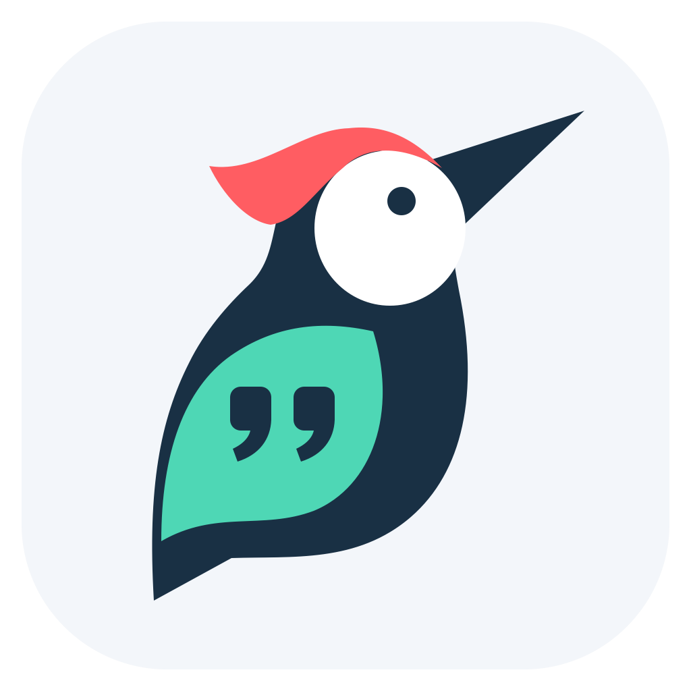
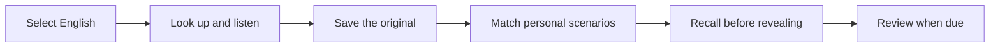

<p align="center">
  
</p>

<h1 align="center">Useleaf · 拾用</h1>
<p align="center">Turn the English you encounter into expressions you can use.</p>
<p align="center"><a href="README.md">简体中文</a> · <a href="https://github.com/yuki-uix/useleaf/releases/latest">Download for macOS</a> · <a href="docs/PRIVACY.md">Privacy</a></p>

Useleaf is a native macOS companion for Chinese speakers learning English through everyday reading. Select a word, phrase or sentence, look it up without leaving your reading flow, and save the original. Practice later with recommendations based on your work and life scenarios, active recall and spaced review.

The current interface and English-to-Chinese translations are designed for Chinese-speaking learners. No account or cloud language-model service is required.

## Download and install

The current release, **0.7.1 (build 10)**, is available for **Apple Silicon Macs (arm64)**. Intel binaries are not included in this release.

- [Latest release](https://github.com/yuki-uix/useleaf/releases/latest)
- [Useleaf 0.7.1 DMG](https://github.com/yuki-uix/useleaf/releases/download/v0.7.1/Useleaf-0.7.1-macos-arm64.dmg)
- [Useleaf 0.7.1 ZIP](https://github.com/yuki-uix/useleaf/releases/download/v0.7.1/Useleaf-0.7.1-macos-arm64.zip)

Open the DMG and drag `Useleaf.app` into **Applications**, or unzip and move the app there. Search for **Useleaf** in Apps or Spotlight to launch it.

This release uses an **ad hoc signature**. It is **not Developer ID signed or notarized**, so macOS may block the first launch. Review [Apple's guide to safely opening apps on your Mac](https://support.apple.com/102445) before deciding whether to allow it. Do not disable macOS security protections.

| Requirement | Availability |
| --- | --- |
| macOS 14+ | Bundled dictionary, pronunciation, collection and learning features |
| macOS 15+ | Apple on-device sentence translation; English and Simplified Chinese language packs required |
| Installed system voices | British (`en-GB`) and American (`en-US`) pronunciation |

## From reading to practice



1. Open Useleaf and enable **Accessibility** in **System Settings → Privacy & Security → Accessibility** when you want cross-app selection capture. Manual lookup works without this permission.
2. Select English in a browser, text-based PDF or another reading app, then press **Control + Option + D (`⌃⌥D`)**. Scanned documents and images do not have OCR support.
3. Read the Chinese meaning or translation, listen in either accent, and save with **`⌘S`**. Press **Esc** to return to reading. Words and known phrases use the bundled dictionary; other selections use Apple Translation when available. You can still save originals if lookup fails.
4. Choose your work and life scenarios from options. Set whether you mainly speak, write, do both, or only need to understand; frequency can remain unspecified.
5. Start a short practice round of up to 10 entries. Recall the meaning or expression before revealing the reference, then assess your answer to schedule the next review. Due reviews come first.

The woodpecker companion gives a single silent confirmation after a successful new save, waits quietly during recall, and rests at the end of a session. Animations respect Reduced Motion; no streaks or reward counters are added.

Pronunciation is also available directly in the collection. Search, undo the most recent deletion, and export originals as TXT or CSV without reopening lookup.

| Suggested purpose | Practice |
| --- | --- |
| Want to use | Recall the English from its meaning and your scenario; try saying or writing it |
| Understand only | Recall the meaning after seeing the English |
| Keep for reference | Retain it for lookup without adding it to the review queue |

**Professional relevance alone defaults to understanding.** A specialist term needs a concrete speaking or writing use case before it is recommended for productive practice. Corpus frequency, repeated lookups and broad industry matches do not establish that need. Your explicit choice for an entry takes priority.

Recommendations use explainable local rules, dictionary evidence and available Natural Language models. They are estimates, not claims about your proficiency or future needs. Practice uses reference-based self-assessment; the app does not automatically grade grammar or spoken answers.

## Local data and permissions

- Saved entries contain only the original words, phrases or sentences. Meanings, translations, sources and page contents are not attached to them.
- Scenario choices, purpose feedback, distinct lookup dates for saved entries and review progress are stored separately.
- Data stays in `~/Library/Application Support/com.yuki.wordshelf/`: `words.json` and `learning.json`. The legacy directory is retained so existing WordShelf / 拾词 users keep their collection and learning progress.
- Accessibility capture runs only when you trigger the shortcut. A temporary copy operation is used when an app does not expose its selection; the clipboard is restored only if no newer change occurred.
- There are no accounts, telemetry, ads or cloud sync. Initial Apple language-pack preparation requires a system download; translation and dictionary lookup run locally.

See [Privacy](docs/PRIVACY.md) for clipboard behavior, storage details and system-service boundaries. Do not attach your real collection or learning profile to public bug reports.

## Build from source

Use **Swift 6.2+** and an Xcode SDK exposing the macOS 26.4 Translation APIs used by the project. The release is built with **Xcode 26.6, macOS SDK 26.5 and Swift 6.3.3**. The deployment target remains macOS 14.

```sh
git clone https://github.com/yuki-uix/useleaf.git
cd useleaf
swift test
scripts/build_app.sh
```

The app is generated at `dist/Useleaf.app`. The bundled dictionary and licenses travel with the app; it does not require the checkout or build cache to run. Swift package and target names remain `WordShelf` for compatibility.

The build defaults to an ad hoc signature. To use an existing signing identity, set `WORDSHELF_SIGNING_IDENTITY`; the script does not create or select a certificate automatically. Updating an ad hoc build can invalidate its previous Accessibility grant: quit Useleaf, remove its old entry from Accessibility settings, add the current app and enable it again.

Native SwiftUI / AppKit, SQLite, Carbon, Accessibility, Natural Language, Apple Translation and AVSpeechSynthesizer; no external Swift package dependencies.

## Contribute and license

Bug reports and contributions are welcome. See [CONTRIBUTING.md](CONTRIBUTING.md) for development and reporting guidance.

Useleaf's application code and original artwork are released under the [MIT License](LICENSE). The bundled **ECDICT** English–Chinese dictionary is derived from [skywind3000/ECDICT](https://github.com/skywind3000/ECDICT) and retains its own MIT copyright and license. See [third-party notices](THIRD_PARTY_NOTICES.md) and [dictionary provenance](ThirdParty/ECDICT/README.md) for the pinned source and reproduction instructions. Apple language models and system voices are supplied by macOS and are not redistributed.
