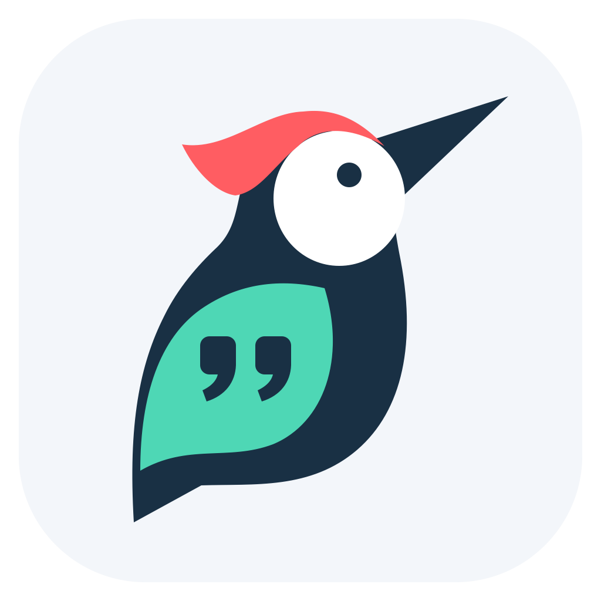
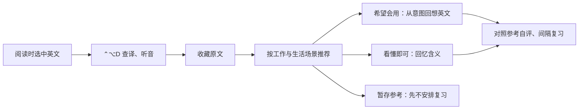

<p align="center">
  
</p>

<h1 align="center">拾用 · Useleaf</h1>

<p align="center">把遇见的英文，变成用得上的表达。</p>

<p align="center">
  <a href="https://github.com/yuki-uix/useleaf/releases/latest">下载 macOS 版</a> ·
  <a href="README.en.md">English</a> ·
  <a href="docs/PRIVACY.md">隐私说明</a> ·
  <a href="https://github.com/yuki-uix/useleaf/issues">反馈问题</a>
</p>

原生 macOS 英语查译与学习工具。阅读英文网页、技术文档或可选中文字的 PDF 时，划词按快捷键，查看中文释义、听发音并收藏。再根据工作与生活中的实际需求，练习理解或主动表达。

无需账户、API Key 或云端大模型。词典、收藏与复习均在本机；句子翻译使用 Apple 本机翻译。

## 下载与安装

**[前往最新版本下载](https://github.com/yuki-uix/useleaf/releases/latest)**

| 下载 | 适用设备 |
| --- | --- |
| `Useleaf-0.7.1-macos-arm64.dmg` | Apple Silicon：M 系列 Mac，拖入「应用程序」安装 |
| `Useleaf-0.7.1-macos-arm64.zip` | 同一应用的 ZIP 压缩包 |
| `SHA256SUMS` | 下载完整性校验值 |

- macOS **14+** 可使用离线词典、收藏、发音与复习；系统句子翻译需要 **macOS 15+** 和中英语言包。
- 当前版本提供 **arm64** 下载，尚未提供经过验证的 Intel / universal 下载。
- 当前下载使用 **ad hoc 签名，未经过 Apple 公证**。首次打开可能被 Gatekeeper 拦截；请先确认仓库与下载来源，再按 [Apple 官方说明](https://support.apple.com/102445)决定是否允许打开。无需关闭系统安全保护。
- 安装后在 Apps 或 Spotlight 搜索 **Useleaf**。从旧版拾词升级时，先退出旧应用，再打开 Useleaf，避免两份应用占用同一快捷键。

## 从阅读到会用



### 阅读时少打断

- 选中单词、短语或句子，按 **Control + Option + D（⌃⌥D）** 打开浮窗。
- 内置 **770,611 条 ECDICT** 离线词条，未收录内容尝试 Apple 本机英译中。
- 浮窗中按 **⌘S** 收藏原文，**Esc** 返回阅读。查译失败时仍可收藏。
- 查词浮窗、生词本和复习页都可播放英式 / 美式系统发音。
- 搜索、删除 / 撤销、TXT / CSV 导出；短语和句子的大小写、标点与内部换行完整保留。

### 把时间用在更值得学的表达上

- 用选项设置工作领域、生活任务、说写或读听目标与使用频率，无需逐词分类。
- 专业领域相关的词默认 **“看懂即可”**，有明确的具体说写需求时才推荐 **“希望会用”**。
- 词频未知不代表低频。通用词频、重复查询和场景频率帮助排序，不能单独证明你需要主动使用某个专业词。
- 每条可展开推荐依据，也可手动调整用途；你的明确选择优先。
- 每轮最多 10 条，优先复习到期内容，再加入新表达。先尝试回忆，再揭示参考、听音与自评；跳过不计学习表现。

小啄会在成功收藏时轻点确认，在回忆时安静等待，并在本轮结束时休息。动画静音且遵循系统“减少动态效果”设置，不增加收藏量奖励或打卡。

推荐采用词法、专业领域线索与本机语义模型，是保守的启发式估计。复习中的自由说写由你对照参考自评，当前不自动判断语法或自由表达是否正确。

## 第一次使用

1. 将 `Useleaf.app` 拖入「应用程序」并打开。
2. 点击 **“开启划词查译”**，到「系统设置 → 隐私与安全性 → 辅助功能」允许 Useleaf。未授权时仍可手动查词。
3. 在阅读应用中选中英文，按 **⌃⌥D**。扫描 PDF 和图片不支持文字识别；阅读应用需提供可选或可复制的文本。
4. 需要句子翻译时，点击 **“启用句子翻译”**，在生词本窗口准备 Apple 中英语言包。之后在本机完成翻译。
5. 在生词本设置场景，再点击 **“开始学习”**。

关闭窗口后应用仍在菜单栏运行。**⌘L** 手动查译、**⌘B** 打开生词本、**⌘E** 导出、**⌘Q** 退出。

如果快捷键被其他应用占用，释放占用后重新打开 Useleaf。更新后若辅助功能开关已开启但应用仍提示未授权，先退出应用，在系统辅助功能列表移除旧条目，再添加「应用程序」中的当前 Useleaf。

## 你的数据

收藏只保存原文，位于：

```text
~/Library/Application Support/com.yuki.wordshelf/words.json
```

场景设置、学习用途反馈和复习状态独立保存在同目录的 `learning.json`。不会保存原文来源、译文、未收藏的查询历史或练习答句。可直接备份这两个文件。

0.7.0 将 **拾词 / WordShelf** 更名为 **拾用 / Useleaf**。保留原应用标识与数据目录，已有收藏和学习资料可直接继续使用。详见 [隐私说明](docs/PRIVACY.md) 与 [品牌说明](docs/BRAND.md)。

## 从源码构建

需要 **Swift 6.2+** 与提供 macOS 26.4 Translation API 的 Xcode SDK。本机验证环境为 Xcode 26.6 / macOS SDK 26.5 / Swift 6.3.3。应用部署目标仍为 macOS 14，无外部 Swift 包依赖。

```sh
git clone https://github.com/yuki-uix/useleaf.git
cd useleaf
swift test
scripts/build_app.sh
```

输出为 `dist/Useleaf.app`，默认编译本机架构，使用 ad hoc 签名。发布打包：

```sh
scripts/package_release.sh
```

生成 DMG、ZIP 与 SHA256SUMS。可用 `WORDSHELF_ARCH=arm64` 或 `x86_64` 显式指定构建架构；交叉编译成功不代表已完成对应硬件验证。已有签名证书时可通过 `WORDSHELF_SIGNING_IDENTITY` 显式指定，脚本不会创建证书或进行公证。

内部 Swift target 与构建产物仍使用 `WordShelf` 名称；应用包入口名为 `Useleaf`，应用标识保留兼容。开发、测试与提交说明见 [CONTRIBUTING.md](CONTRIBUTING.md)。

## 开源与致谢

应用源码和原创图标使用 [MIT License](LICENSE)。欢迎提交 Issue 与 Pull Request。

离线词典来自 [skywind3000/ECDICT](https://github.com/skywind3000/ECDICT)，保留其 MIT 许可与原作者声明。[固定版本、校验值与重建方式](ThirdParty/ECDICT/README.md) · [第三方声明](THIRD_PARTY_NOTICES.md)。

Apple 翻译语言包与系统语音由 macOS 提供，不随本项目分发。
